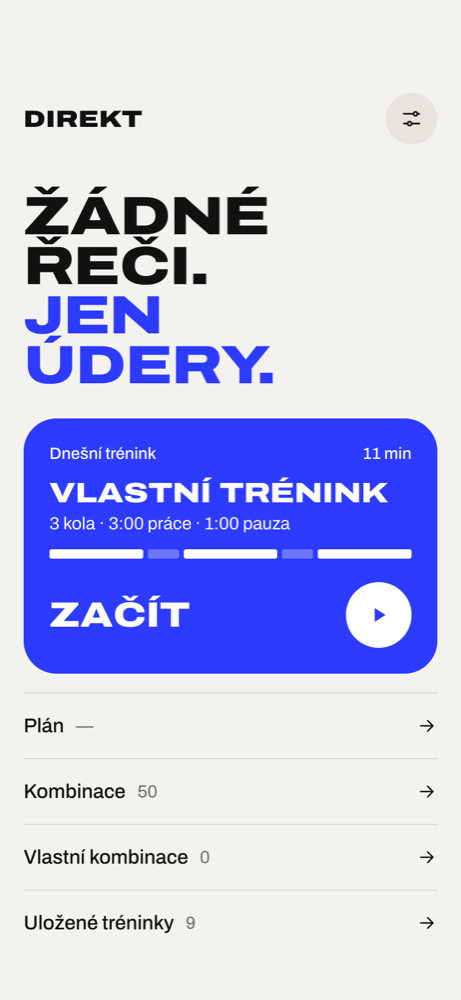
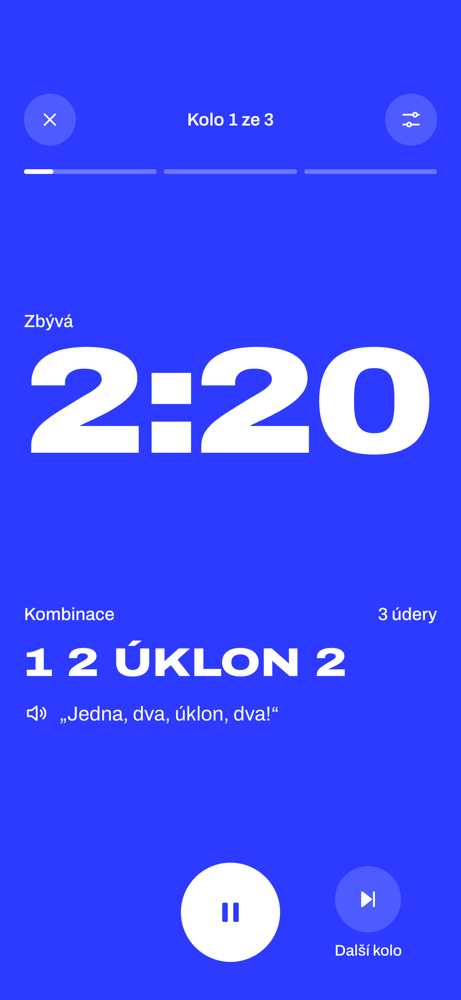
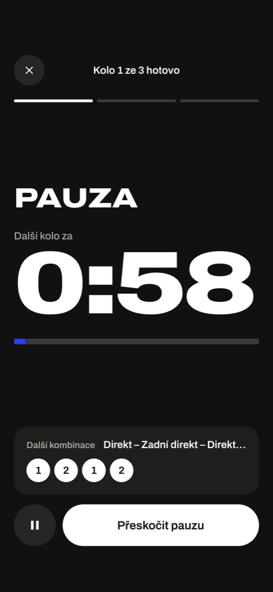
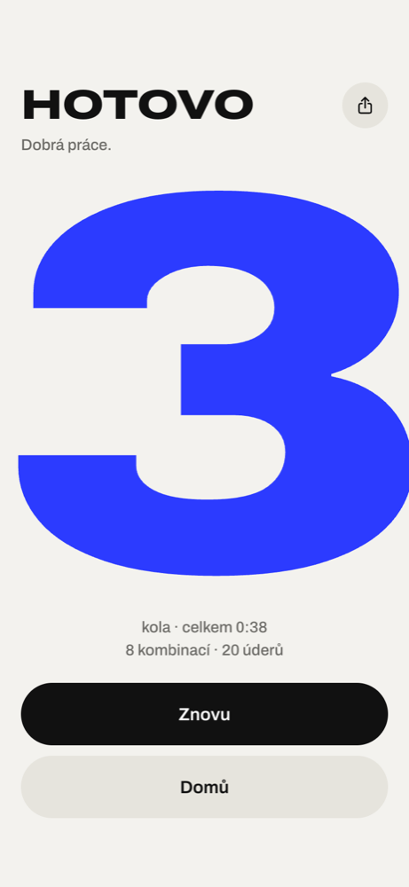
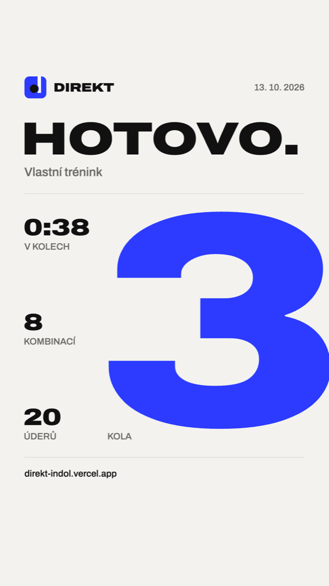

# DIREKT

Trenér na boxovací pytel pro iPhone. Telefon leží u pytle, hlas během kola hlásí kombinace
čísly („jedna, dva, tři na tělo, úklon" / „one, two, three body, slip"), gong začíná a končí
kola, mezi koly běží pauza. Jen box. Web appka přidaná na plochu — offline, bez účtu a bez serveru.

**Živě: https://direkt-indol.vercel.app** (na iPhonu v Safari → Sdílet → Přidat na plochu)

<p>
  
  
  
  
</p>

## Co umí

- **Hlášení čísly** podle boxerského číslování (1 direkt, 2 zadní direkt, 3 hák, 4 zadní hák,
  5 zvedák, 6 zadní zvedák, „na tělo") a povely obrany z lap: úklon, záklon, dolů, kryt, vzad,
  stranou.
- **105 kombinací od skutečných trenérů** ve třech úrovních (začátečník, pokročilý, expert):
  mistři světa WBA Yodsanan Sityodtong a Drian Francisco (Evolve), Johnny Nguyen (ExpertBoxing),
  Tommy Duquette (USA Boxing). Každá doslova podle trenéra, i s obranou; zapnout/vypnout,
  **vlastní kombinace** z klávesnice úderů.
- **Kola, pauza, odpočet** nastavitelné; 4 tempa — lehké, střední, tvrdé a rostoucí (od
  lehkého v prvním kole po tvrdé v posledním).
- **Čas na úder** 0,3–0,7 s (výchozí 0,5 s) — jak svižně jdou kombinace za sebou.
- **Finiš:** posledních 10 s kola „Naplno!" a žádné kombinace, jen údery do gongu.
  Trenér občas zavelí **„Znovu!"** — stejná kombinace ještě jednou.
- **9 uložených tréninků** podle pravidel a trenérské praxe (rozcvička, amatérský zápas 3 × 3,
  profi kola, titulový zápas 12 × 3 …) a vlastní tréninky.
- **Plán na 4 týdny** ze 3 otázek (zkušenost, cíle, čas); každý týden kolo navíc, nebo kratší
  pauza.
- **4 hlasy trenéra:** Harry, Charlie, Adam (angličtina, nabuzené výkřiky) a Antonín (čeština).
- **Sdílení výsledku** z obrazovky Hotovo jako obrázek do IG story:

  

- Rozhraní **česky i anglicky**, nezávisle na jazyku hlasu.
- Nic se neukládá na server; nastavení, vlastní kombinace a postup plánu žijí v telefonu.

## Při tréninku

- Telefon nech ležet u pytle s displejem zapnutým — appka drží displej rozsvícený.
- Zamčení nebo přepnutí appky trénink pozastaví (vypnout jde v Nastavení).
- Hudba ze Spotify hraje dál, ale při hlášení se **neztiší** — web appka to neumí, hlas ji musí
  přehlušit sám.
- Když je iPhone v tichém režimu a nic neslyšíš: Nastavení → **Hrát i v tichém režimu**
  (zastaví ale hudbu z telefonu).
- Appka na ploše má vlastní úložiště, oddělené od Safari.

## Vývoj

Co a proč se staví, je v **[DOKUMENTACE.md](DOKUMENTACE.md)** — je to smlouva: změna nejdřív
tam, pak kód. Jsou v ní i ověřené pasti iOS (R1–R17): zvuk jen z ťuknutí, uspávání audia,
wake lock, stavová lišta, písmo v canvasu ve WebKitu.

```bash
nvm use 20        # Vite 8 vyžaduje Node >= 20.19
npm install
npm run dev
npm test          # engine: výběr kombinací, časování, finiš, plán, časová osa, úložiště, texty
npm run build     # tsc -b && vite build
npm run lint      # oxlint
npm run icons     # přegeneruje ikony appky
npx vercel deploy --prod --yes
```

Stack: Vite 8 + React 19 + TypeScript, čisté CSS, `vite-plugin-pwa`, testy vitest. Žádné další
běhové závislosti.

| Kde | Co |
|---|---|
| `src/engine/` | čistý TypeScript bez DOM: výběr kombinací, časová osa tréninku, tempo, plán — plně testovaný |
| `src/workout/runner.ts` | běh tréninku: hodiny, gong, hlášení, pauza, přeskočení |
| `src/audio/` | Web Audio: hlasové klipy, syntéza gongu a pípání, keep-alive, wake lock |
| `src/ui/` | obrazovky; `shareCard.ts` kreslí obrázek ke sdílení |
| `src/data/` | kombinace, slova úderů pro oba jazyky, hlasy |
| `src/i18n/` | texty rozhraní `cs.ts` a `en.ts` (stejný tvar, TypeScript hlídá, že nic nechybí) |
| `public/voice/<hlas>/` | předgenerované hlasové klipy (MP3) |
| `design/` | předlohy obrazovek, onboardingu a ikony |
| `marketing/` | podklady pro FB post, IG story a videa (HTML vykreslené přes Chrome) |
| `scripts/` | generování hlasu (`gen-voice.py`) a ikon |

Hlasové klipy generuje `scripts/gen-voice.py` (postup v hlavičce skriptu; `--clip <id>`
přegeneruje jen vybrané). Klíč ElevenLabs čte z `~/.config/elevenlabs.key` nebo
`ELEVENLABS_API_KEY` — do repa nepatří.

Kdyby se v telefonu zasekla stará verze: otevřít adresu s `?sw-reset` — zahodí service worker
i cache.

## Zdroje

- Písmo [Archivo](https://github.com/Omnibus-Type/Archivo) (SIL Open Font License 1.1,
  `public/fonts/OFL.txt`); statické řezy pro obrázek ke sdílení jsou z něj odvozené.
- Hlasy Harry, Charlie a Adam: [ElevenLabs](https://elevenlabs.io). Antonín: Microsoft
  `cs-CZ-AntoninNeural`.
- Číslování úderů a česká terminologie: zdroje v DOKUMENTACE.md, kap. 5.
- Kombinace: každá má v DOKUMENTACE.md, kap. 6 trenéra a odkaz na lekci nebo článek.
- Čas na úder: měření závodních boxerů
  ([Piorkowski et al. 2011](https://clok.uclan.ac.uk/3757/1/piorkowski-et-al-2011-punch-kinematics.pdf)), DOKUMENTACE.md, kap. 7.2.

## English

DIREKT is a heavy bag coach for iPhone: a voice calls boxing combos by number during the round,
a bell starts and ends rounds, rest runs in between. 105 combos taken word for word from real
coaches (WBA world champions Yodsanan Sityodtong and Drian Francisco, ExpertBoxing, USA Boxing),
adjustable time per punch. Installable web app (PWA), offline, no account, no server. UI in
Czech and English. Live at https://direkt-indol.vercel.app — the
spec (in Czech) is [DOKUMENTACE.md](DOKUMENTACE.md).
